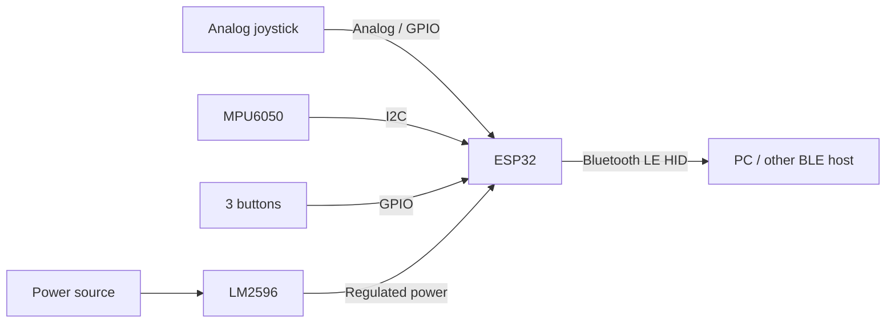

# BedPad

A small ESP32-based BLE controller for mouse and keyboard input. It combines a joystick, an MPU6050 motion sensor, and three programmable buttons in one handheld device.

## Hardware

- ESP32 development board
- MPU6050 accelerometer and gyroscope
- Analog joystick with push button
- 3 momentary push buttons
- LM2596 DC-DC step-down converter

## System overview

The ESP32 reads the physical controls and sends mouse or keyboard events over Bluetooth Low Energy (BLE). The MPU6050 provides motion data for gesture or pointer control.

## Wiring

The exact GPIO assignments will be added once the hardware layout is finalized.

| Component | Signal | ESP32 connection |
| --- | --- | --- |
| Joystick | X axis | ADC-capable GPIO (TBD) |
| Joystick | Y axis | ADC-capable GPIO (TBD) |
| Joystick | Switch | Digital GPIO (TBD) |
| MPU6050 | SDA | I2C SDA (TBD) |
| MPU6050 | SCL | I2C SCL (TBD) |
| Button 1 | Input | Digital GPIO (TBD) |
| Button 2 | Input | Digital GPIO (TBD) |
| Button 3 | Input | Digital GPIO (TBD) |
| LM2596 | Regulated output | ESP32 board power input (TBD) |

> **Electrical note:** ESP32 GPIO uses 3.3 V logic. Do not connect 5 V signals directly to GPIO pins. Set and verify the LM2596 output before connecting the board, and use the power input specified for your ESP32 board.

## Software

The firmware is intended to handle:

- BLE HID mouse and keyboard reports
- Joystick input
- MPU6050 readings
- Programmable button actions

## Status

Work in progress. Pin assignments, firmware setup, and control mappings will be documented as the prototype develops.
