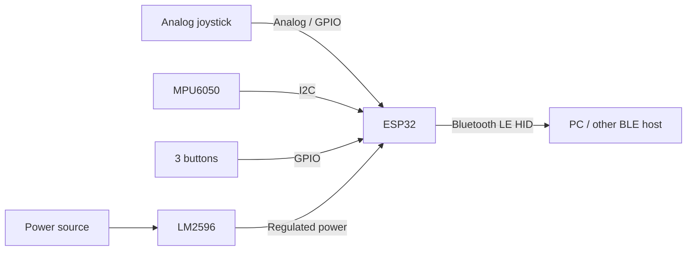

# BedPad

A small ESP32-based BLE controller for mouse and keyboard input. It combines a joystick, an MPU6050 motion sensor, and three programmable buttons in one handheld device.

## Hardware

- ESP32 development board
- MPU6050 accelerometer and gyroscope
- Analog joystick with push button
- 3 momentary push buttons
- LM2596 DC-DC step-down converter

## System overview



The ESP32 reads the physical controls and sends mouse or keyboard events over Bluetooth Low Energy (BLE). The MPU6050 provides motion data for gesture or pointer control.

## Wiring

The exact GPIO assignments will be added once the hardware layout is finalized.

| Component | Signal | ESP32 connection |
| --- | --- | --- |
| Joystick | X axis | ADC-capable GPIO (TBD) |
| Joystick | Y axis | ADC-capable GPIO (TBD) |
| Joystick | Switch | Digital GPIO (TBD) |
| MPU6050 | SDA | I2C SDA (TBD) |
| MPU6050 | SCL | I2C SCL (TBD) |
| Button 1 | Input | Digital GPIO (TBD) |
| Button 2 | Input | Digital GPIO (TBD) |
| Button 3 | Input | Digital GPIO (TBD) |
| LM2596 | Regulated output | ESP32 board power input (TBD) |

> **Electrical note:** ESP32 GPIO uses 3.3 V logic. Do not connect 5 V signals directly to GPIO pins. Set and verify the LM2596 output before connecting the board, and use the power input specified for your ESP32 board.

## Software

### ESP-IDF hello world (ESP32-WROOM-32)

The project currently runs a GPIO interrupt button test on the `esp32`
target. Connect each button between its GPIO and GND; internal pull-ups are
enabled. GPIO27 is MIDDLE, GPIO26 is RIGHT, and GPIO25 is LEFT.
Both edges trigger an ISR that wakes a task. The task debounces each button
for 30 ms and logs PRESSED / RELEASED at 115200 baud. No logging runs in the
ISR. Pulses shorter than the debounce interval may be ignored. The test runs
continuously without restarting. The controller features below are planned.

Joystick: VCC to 3.3 V, GND to GND, VRx to GPIO34 (ADC1 channel 6),
VRy to GPIO35 (ADC1 channel 7), SW to GPIO32. Do not power the joystick from
5 V with analog outputs directly connected to the ESP32.
The monitor prints raw 12-bit X/Y readings (0..4095), averaged over 16 samples,
every 200 ms. Center need not be exactly 2048; ADC nonlinearity and high-end
saturation mean these readings test movement rather than measure voltage.
The switch uses the same IRQ debounce as the buttons, logged as JOYSTICK_SW.

In VS Code, select the installed ESP-IDF setup using
`ESP-IDF: Select Current ESP-IDF Version`, then run `ESP-IDF: Build Your Project`.
Use `ESP-IDF: Select Port to Use` to select the board's COM port, then
`ESP-IDF: Flash Your Project` and `ESP-IDF: Monitor Your Device`.

Alternatively, open the installed ESP-IDF PowerShell terminal in this folder:

```powershell
idf.py build
idf.py -p COM5 flash monitor
```

Replace `COM5` with the actual port. Exit the monitor with `Ctrl+]`.
The serial monitor uses 115200 baud. If connection stalls, hold BOOT while
connecting and release it once writing starts.

The firmware is intended to handle:

- BLE HID mouse and keyboard reports
- Joystick input
- MPU6050 readings
- Programmable button actions

## Status

Work in progress. Pin assignments, firmware setup, and control mappings will be documented as the prototype develops.
